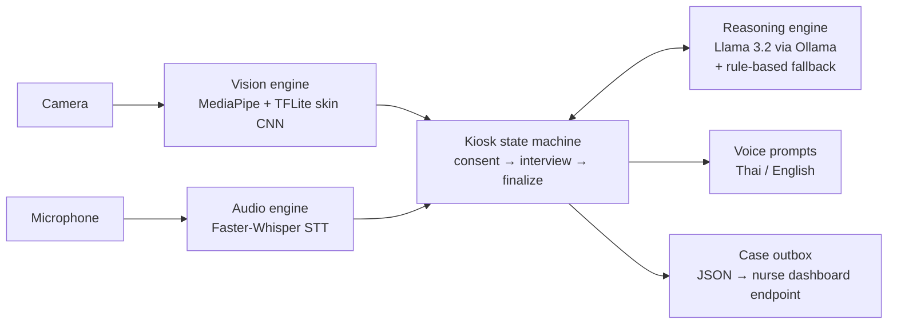

# Multimodal Pre-Triage Assistance

[](https://github.com/PhokinWanna/multimodal-pre-triage-simulation/actions/workflows/tests.yml)

[](LICENSE)

A bilingual (Thai/English) kiosk simulation that combines **computer vision**,
**speech interaction**, and a **local LLM** to collect a patient's symptoms
and suggest an Emergency Severity Index (ESI) level before a nurse sees them.

> Research and engineering prototype, not a medical device. This repository
> is a public snapshot of an ongoing university project (Digital Engineering
> Project, course 977-302); newer research work is kept private.

## Highlights

- **Vision:** MediaPipe face and pose landmarks plus an on-device TFLite CNN
  that classifies facial skin patches as *Normal* or *Flushing*.
- **Speech:** local Faster-Whisper speech-to-text and pre-recorded Thai/English
  voice prompts.
- **Reasoning:** Llama 3.2 running locally through Ollama conducts an
  OPQRST-style symptom interview and proposes an ESI level, with a
  deterministic rule-based fallback if the LLM times out.
- **Privacy by design:** verbal PDPA consent before any data is collected; on
  refusal, only an anonymous nurse-assistance event is sent. Patient text is
  never sent to external text-to-speech.
- **Safety rules:** emergency keywords interrupt the interview (ESI 1–2), and
  three off-topic answers in a row are flagged as possible altered mental status.

## Architecture



## Results: skin-flushing CNN

The skin CNN was developed in three stages, all at threshold 0.50:

| Model | Loss / class weighting | Evaluation set | Accuracy | Precision | Recall | Specificity | F1 | ROC-AUC |
| --- | --- | --- | ---: | ---: | ---: | ---: | ---: | ---: |
| Model-01 | Cross-entropy, 0.5/0.5 | Historical test (3,719) | 0.799 | 0.521 | 0.883 | 0.776 | 0.655 | 0.914 |
| Model-02 | Focal loss, α=0.25 | Original validation (3,791) | 0.838 | 0.982 | 0.264 | 0.999 | 0.417 | 0.974 |
| Model-03 | Focal loss, α=0.25 | Grouped test (3,748) | 0.918 | 0.944 | 0.661 | 0.989 | 0.778 | 0.984 |
| **Model-03** | **Focal loss, α=0.75** | Grouped test (3,748) | **0.960** | **0.954** | **0.857** | **0.988** | **0.903** | **0.993** |

- **Model-01** caught most flushing but raised many false alarms (654).
- **Model-02** used focal loss to cut false alarms to 4, but missed most
  flushing (recall 0.26).
- **Model-03** re-weighted the Flushing class (α 0.25 → 0.75) on a rebuilt
  split. In this controlled comparison on the same test set, recall rose by
  about 20 percentage points without losing precision.

Model-01 and Model-02 were evaluated on their own historical splits, so only
the two Model-03 rows are a like-for-like comparison.


**Limitations:** the evaluation is patch-level and grouped by filename prefix,
not verified person-disjoint, so identity leakage is possible. The Model-03
checkpoints are research artifacts and are not yet wired into the kiosk. Full
details are in
[`FINAL_SUMMARY.md`](scripts/train/cnn/model03/results/FINAL_SUMMARY.md).

## Project layout

| Path | Contents |
| --- | --- |
| `src/triage_kiosk/` | Kiosk application: `vision/`, `audio/`, `triage/`, consent and TTS privacy helpers |
| `tests/` | Unit tests for consent, TTS privacy, vision preprocessing, and triage fallback |
| `models/` | TFLite skin classifier used by the kiosk |
| `assets/audio/` | Pre-recorded Thai and English voice prompts |
| `scripts/data/` | Face-patch extraction for CNN training |
| `scripts/train/cnn/` | Dataset splitting, Model-02 training, Model-03 experiment and results |
| `scripts/audio/` | Voice-prompt generation utility |
| `data/` | Local datasets and runtime output (not committed) |
| `docs/data/` | Dataset sources, licences, and limitations |

## Getting started

Requires Python 3.11, a webcam, a microphone, and [Ollama](https://ollama.com)
with the Llama 3.2 model.

```bash
python3.11 -m venv .venv-kiosk
source .venv-kiosk/bin/activate
python -m pip install -r requirements-kiosk.txt
brew install portaudio        # macOS, needed by PyAudio
ollama pull llama3.2

PYTHONPATH=src python -m triage_kiosk.main
```

The first run downloads the Faster-Whisper model. Cloud speech recognition is
off by default; set `ALLOW_CLOUD_SPEECH_RECOGNITION=1` only if you accept
sending audio to Google when local transcription fails.
Logs print at INFO level; run with `LOG_LEVEL=DEBUG` to also see
transcribed speech while debugging.

Run the tests (no camera, microphone, or Ollama needed):

```bash
python -m pip install -r requirements-test.txt
PYTHONPATH=src python -m pytest
```

### CNN training pipeline

Use a separate environment with `requirements-cnn.txt`. The image dataset is
not included; see [`data/dataset-cnn/README.md`](data/dataset-cnn/README.md).
Place images in `data/dataset-cnn/{Normal,Flushing}/`, then:

```bash
python scripts/data/dataset_extraction-CNN.py   # extract 64x64 face patches
python scripts/train/cnn/split_dataset.py       # 70/15/15 prefix-grouped split
python scripts/train/cnn/train_skin_cnn-02.py   # train the CNN
```

More detail: [`scripts/train/cnn/SPLIT_README.md`](scripts/train/cnn/SPLIT_README.md).

## Current status

- The nurse dashboard is planned but not built yet; the kiosk currently posts
  cases to a configurable endpoint.
- Some pre-recorded alerts mention notifying a nurse; treat these as simulated
  until the dashboard exists.
- Systematic LLM scenario testing is planned work.

## License

Source code is released under the [MIT License](LICENSE). The trained model
file and the third-party datasets behind it have their own terms; see
[`docs/data/README.md`](docs/data/README.md).

## Disclaimer

This is a research simulation. It is not a medical device and must not be used
for real clinical decisions.
