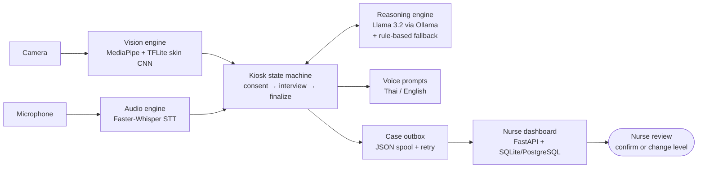
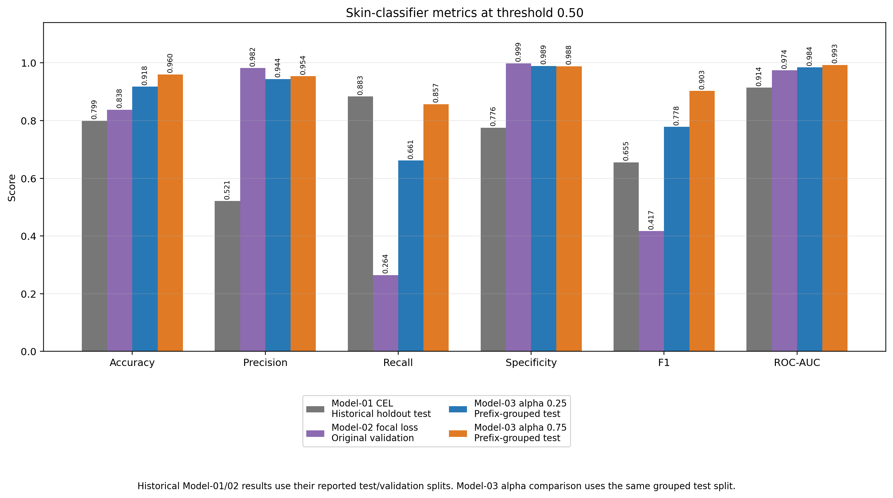
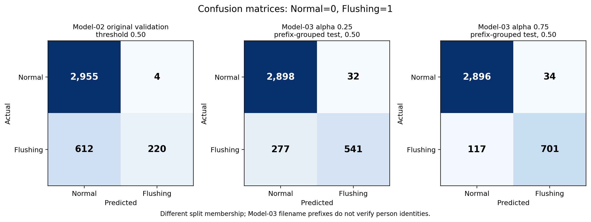

# Multimodal Pre-Triage Assistance

[](https://github.com/PhokinWanna/multimodal-pre-triage-simulation/actions/workflows/tests.yml)

[](LICENSE)

A bilingual (Thai/English) kiosk simulation that combines **computer vision**,
**speech interaction**, and a **local LLM** to collect a patient's symptoms
and suggest an Emergency Severity Index (ESI) level before a nurse sees them.

> Research and engineering prototype, not a medical device. This repository
> is a public snapshot of an ongoing university project (Digital Engineering
> Project, course 977-302); newer research work is kept private.

## Highlights

- **Vision:** MediaPipe face and pose landmarks plus an on-device TFLite CNN
  that classifies facial skin patches as *Normal* or *Flushing*.
- **Speech:** local Faster-Whisper speech-to-text (Thai/English detected
  automatically), pre-recorded voice prompts, and the offline macOS voices for the
  interview questions.
- **Interview:** a fixed, step-by-step intake (main complaint → pain score 0–10 →
  onset → "anything else?"), so questions are never repeated.
- **Reasoning:** Llama 3.2 running locally through Ollama writes the SOAP note and
  proposes an ESI level, with a deterministic rule-based fallback if the LLM times
  out and a safety floor that the LLM cannot override (emergency words, chest
  clutching, pain ≥ 7/10).
- **Privacy by design:** verbal PDPA consent before any data is collected; on
  refusal, only an anonymous nurse-assistance event is sent. Patient text is
  never sent to external text-to-speech.
- **Safety rules:** emergency keywords interrupt the interview (ESI 1–2), and
  three off-topic answers in a row are flagged as possible altered mental status.
- **Nurse dashboard:** a browser-based staff view (FastAPI, SQLite or PostgreSQL)
  with a live queue, a case page laid out like a triage note, nurse-entered
  vital signs and identification, and a human-in-the-loop review where the
  nurse confirms or changes the kiosk's suggested level.

## Architecture



## Results: skin-flushing CNN

The skin CNN was developed in three stages, all at threshold 0.50:

| Model | Loss / class weighting | Evaluation set | Accuracy | Precision | Recall | Specificity | F1 | ROC-AUC |
| --- | --- | --- | ---: | ---: | ---: | ---: | ---: | ---: |
| Model-01 | Cross-entropy, 0.5/0.5 | Historical test (3,719) | 0.799 | 0.521 | 0.883 | 0.776 | 0.655 | 0.914 |
| Model-02 | Focal loss, α=0.25 | Original validation (3,791) | 0.838 | 0.982 | 0.264 | 0.999 | 0.417 | 0.974 |
| Model-03 | Focal loss, α=0.25 | Grouped test (3,748) | 0.918 | 0.944 | 0.661 | 0.989 | 0.778 | 0.984 |
| **Model-03** | **Focal loss, α=0.75** | Grouped test (3,748) | **0.960** | **0.954** | **0.857** | **0.988** | **0.903** | **0.993** |

- **Model-01** caught most flushing but raised many false alarms (654).
- **Model-02** used focal loss to cut false alarms to 4, but missed most
  flushing (recall 0.26).
- **Model-03** re-weighted the Flushing class (α 0.25 → 0.75) on a rebuilt
  split. In this controlled comparison on the same test set, recall rose by
  about 20 percentage points without losing precision.

Model-01 and Model-02 were evaluated on their own historical splits, so only
the two Model-03 rows are a like-for-like comparison.





**Limitations:** the evaluation is patch-level and grouped by filename prefix,
not verified person-disjoint, so identity leakage is possible. The Model-03
α = 0.75 best checkpoint is the model the kiosk now uses
(`models/skin_classifier.tflite`, see [`models/README.md`](models/README.md)). Full
details are in
[`FINAL_SUMMARY.md`](scripts/train/cnn/model03/results/FINAL_SUMMARY.md).

## Project layout

| Path | Contents |
| --- | --- |
| `src/triage_kiosk/` | Kiosk application: `vision/`, `audio/`, `triage/`, consent, outbox and TTS privacy helpers |
| `src/nurse_dashboard/` | Nurse dashboard: API, pages, review, reports, admin, retention |
| `tests/` | Unit tests for the kiosk; `tests/dashboard/` for the dashboard (SQLite and PostgreSQL) |
| `docs/nurse_dashboard/` | [Dashboard user manual](docs/nurse_dashboard/USER_MANUAL.md) with screenshots |
| `models/` | TFLite skin classifier used by the kiosk |
| `assets/audio/` | Pre-recorded Thai and English voice prompts |
| `scripts/data/` | Face-patch extraction for CNN training |
| `scripts/train/cnn/` | Dataset splitting, Model-02 training, Model-03 experiment and results |
| `scripts/audio/` | Voice-prompt generation utility |
| `data/` | Local datasets and runtime output (not committed) |
| `docs/data/` | Dataset sources, licences, and limitations |

## Getting started

Tested on macOS (Apple Silicon, M1) with Python 3.11. Needs a webcam, a microphone,
a speaker and [Ollama](https://ollama.com). On Linux, install `portaudio19-dev` and
`libgl1` first; interview questions then use the generic recording, because the
offline voices (`say`) are macOS-only.

```bash
brew install portaudio            # macOS: needed BEFORE installing PyAudio
python3.11 -m venv .venv-kiosk
source .venv-kiosk/bin/activate
python -m pip install -r requirements-kiosk.txt
ollama pull llama3.2              # with the Ollama app running
```

Optional but recommended: download the Thai voice **Kanya** (System Settings →
Accessibility → Spoken Content → System voice → Manage Voices → Thai). The first kiosk
run downloads the Faster-Whisper model (~500 MB) and asks for camera/microphone access.

**Run the whole system** (three terminals, from the repository root):

```bash
# 1. dashboard (its own environment, see below)
export DASHBOARD_KIOSK_KEY=pick-any-shared-secret
PYTHONPATH=src python -m uvicorn nurse_dashboard.app:app --port 8000

# 2. pre-flight check of camera, mic, voices, Ollama and dashboard (must end with 0 FAIL)
export NURSE_DASHBOARD_KEY=pick-any-shared-secret      # same value as DASHBOARD_KIOSK_KEY
PYTHONPATH=src python scripts/checks/kiosk_preflight.py --full

# 3. kiosk (same terminal as step 2)
PYTHONPATH=src python -m triage_kiosk.main             # press q in the camera window to quit
```

Cases go to `http://127.0.0.1:8000/api/triage/submit_case` (change with
`NURSE_DASHBOARD_ENDPOINT`). If the dashboard is down, cases wait in
`data/runtime/spool_outbox/` and are re-sent automatically. Test scenarios and a demo
script: [docs/demo/REAL_WORLD_TEST.md](docs/demo/REAL_WORLD_TEST.md).

Useful settings (environment variables): `KIOSK_LOG_TRANSCRIPTS=1` prints what Whisper
heard; `MIC_ENERGY_THRESHOLD=600` for a noisy room; `WHISPER_MODEL=medium` for better
Thai (slower); `INTERVIEW_MODE=llm` for the original free-form LLM questions.
Cloud speech recognition is off by default (`ALLOW_CLOUD_SPEECH_RECOGNITION=1` sends
audio to Google).

Run the tests (no camera, microphone, or Ollama needed):

```bash
python -m pip install -r requirements-test.txt
python -m pytest                 # includes a simulated end-to-end kiosk run
```

### Nurse dashboard

Use a separate environment (Python 3.11 or newer):

```bash
python -m venv .venv-dashboard && source .venv-dashboard/bin/activate
python -m pip install -r requirements-dashboard.txt
PYTHONPATH=src python -m nurse_dashboard create-admin   # first time only
PYTHONPATH=src python -m nurse_dashboard create-user    # e.g. a nurse account
PYTHONPATH=src python -m uvicorn nurse_dashboard.app:app --port 8000
NURSE_DASHBOARD_KEY=pick-any-shared-secret python scripts/dashboard/send_demo_cases.py  # optional: fake cases
```

Open `http://127.0.0.1:8000`. Full guide for nurses, admins and setup:
[`docs/nurse_dashboard/USER_MANUAL.md`](docs/nurse_dashboard/USER_MANUAL.md).

### CNN training pipeline

Use a separate environment with `requirements-cnn.txt`. The image dataset is
not included; see [`data/dataset-cnn/README.md`](data/dataset-cnn/README.md).
Place images in `data/dataset-cnn/{Normal,Flushing}/`, then:

```bash
python scripts/data/dataset_extraction-CNN.py   # extract 64x64 face patches
python scripts/train/cnn/split_dataset.py       # 70/15/15 prefix-grouped split
python scripts/train/cnn/train_skin_cnn-02.py   # train the CNN
```

More detail: [`scripts/train/cnn/SPLIT_README.md`](scripts/train/cnn/SPLIT_README.md).

## Current status

- The nurse dashboard is built and tested, but has not yet been evaluated with
  nurses; a System Usability Scale (SUS) session is planned.
- The kiosk does not measure vital signs or collect identity; nurses add both
  at the dashboard.
- Systematic LLM scenario testing (experiment M3) is in progress.

## License

Source code is released under the [MIT License](LICENSE). The trained model
file and the third-party datasets behind it have their own terms; see
[`docs/data/README.md`](docs/data/README.md).

## Disclaimer

This is a research simulation. It is not a medical device and must not be used
for real clinical decisions.
