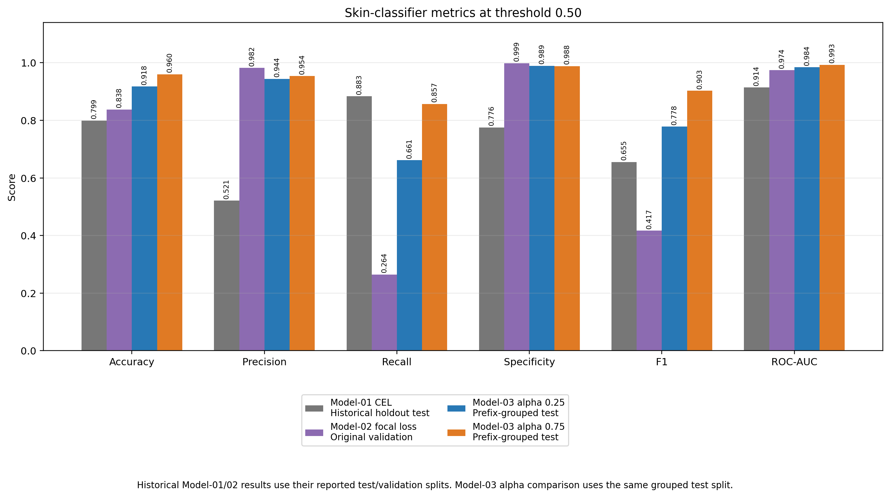
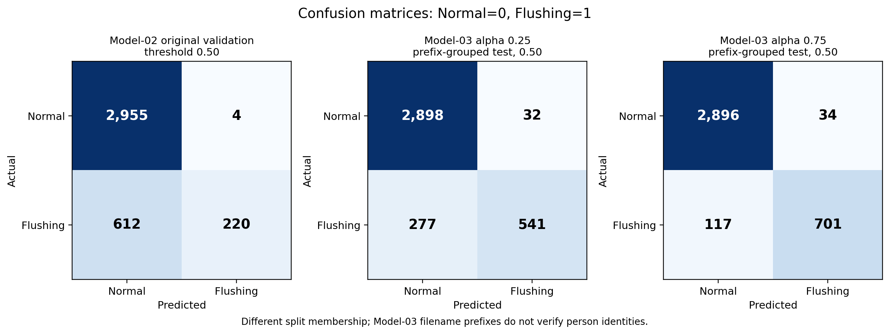
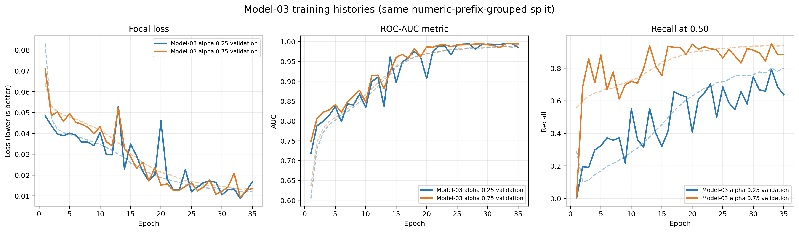
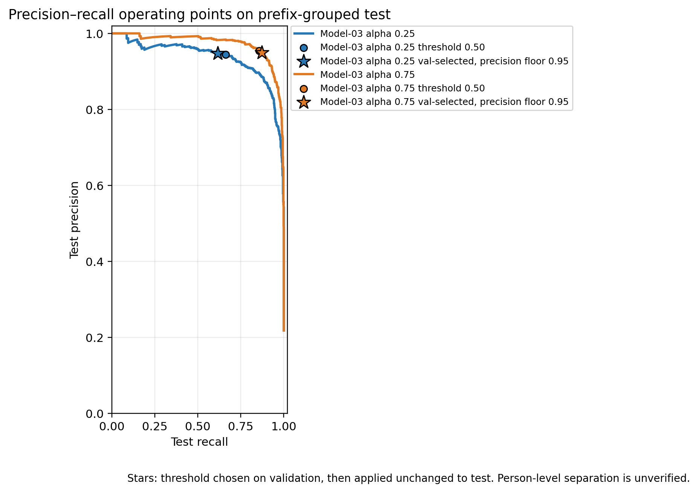
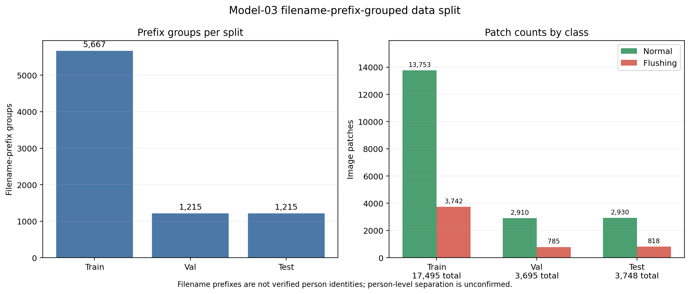

# Model-01 to Model-03 CNN development: full experiment summary

## Executive summary

The skin CNN went through three stages. **Model-01** used the same
architecture as Model-02 but standard binary cross-entropy loss (CEL) with
unadjusted 0.5/0.5 class weighting: it caught most Flushing patches
(recall 0.8832) but raised many false alarms (precision 0.5209). **Model-02**
switched to binary focal loss to reduce those false alarms. Model-02 reported high ROC-AUC (0.9738) but low Flushing recall (0.2644) at a
0.50 threshold. Investigation found two relevant issues:

1. ROC-AUC measures ranking across thresholds; it does not imply that recall
   will be high at the default 0.50 threshold.
2. Model-02's focal loss assigned only 0.25 alpha weight to the positive
   `Flushing` class (`Normal=0`, `Flushing=1`), so the loss emphasized the
   Normal class instead.

The old data split grouped images separately within each class, so 1,033
numeric filename-prefix groups occurred in more than one old
train/validation/test partition. The experiment rebuilt a deterministic split
that keeps each leading numeric filename prefix in one partition across
classes. However, prefixes are not verified person identifiers: the owner
reports that different prefixes can belong to the same person, and the source
data combine multiple datasets. The split is therefore prefix-grouped, not
verified person-disjoint, and identity leakage remains possible. The controlled
alpha comparison keeps this same split and other training settings fixed.

On the resulting held-out test set, alpha 0.75 achieved ROC-AUC **0.9926**,
average precision **0.9726**, recall **0.8570**, precision **0.9537**, and
specificity **0.9884** at threshold 0.50. With a threshold chosen on validation
to satisfy precision of at least 0.95, test recall was **0.8729** and test
precision was **0.9495**. These are promising experimental results, not
clinical validation or an approved deployment threshold.

## What the example papers suggest presenting

The three supplied papers were reviewed for their searchable figure/table
captions and metric reporting:

- The LLM comparison paper uses a research pipeline figure and quantitative
  and human-evaluation comparison tables.
- The emerald-classification paper discusses a confusion matrix and reports
  accuracy, precision, recall, and F1 together.
- The Thai Alzheimer’s screening paper reports a model-metric comparison table,
  multiple confusion matrices, and training/validation performance curves.

Those examples informed the evidence produced here: a method/split description,
controlled parameter comparison, metric chart/table, confusion matrices,
training-history plots, ranking curves, and operating-threshold analysis. No
paper figures were copied into this report.

## Model-02 and Model-03: what changed

“Model-03” here means this fine-tuning experiment, not a completed deployment
model. `focal_alpha_025` is a retrained controlled baseline using Model-02's
positive alpha; `focal_alpha_075` is the candidate fine-tuned model. Both were
trained from scratch on the same corrected split.

| Component | Model-01 CEL | Model-02 original | Model-03 alpha 0.25 | Model-03 alpha 0.75 |
| --- | --- | --- | --- | --- |
| Task/classes | Same as Model-02 | Normal=0; Flushing=1 | Same | Same |
| Input | Same as Model-02 | 64×64×3 | Same | Same |
| Color preprocessing | Same as Model-02 | OpenCV BGR→CIELAB, float32 / 255 | Same | Same |
| Augmentation | Same as Model-02 | Random horizontal flip; random rotation 0.05 | Same | Same |
| CNN | Same as Model-02 | Conv2D 32 (stride 2) + BN; separable Conv2D 64 + BN + max-pool; separable Conv2D 128 + BN; global average pooling; dropout 0.3; Dense sigmoid | Same | Same |
| Hidden activation | Same as Model-02 | ReLU | Same | Same |
| Output activation | Same as Model-02 | Sigmoid | Same | Same |
| Optimizer | Same as Model-02 | Legacy Adam | Same | Same |
| Learning rate | Same as Model-02 | 0.0001 | Same | Same |
| Batch size / max epochs | Same as Model-02 | 32 / 35 | Same | Same |
| Loss | **Binary cross-entropy (CEL)** | Binary focal loss, gamma=2, alpha=0.25 | Same | Binary focal loss, gamma=2, **alpha=0.75** |
| Positive-class weight in loss | **Unadjusted: Flushing 0.5; Normal 0.5** | Flushing receives 0.25; Normal 0.75 | Same | **Flushing 0.75; Normal 0.25** |
| Data split | Historical holdout split (3,719 test patches) | Old per-class numeric-prefix grouping; 1,033 prefix groups cross splits | New globally numeric-prefix-grouped split | Same split as alpha 0.25 |
| Checkpoint selection | Same as Model-02 | Best validation AUC; patience 8 | Same | Same |
| Evaluation threshold | 0.50 on its holdout test set | 0.50 in original report | 0.50 plus validation-selected thresholds | 0.50 plus validation-selected thresholds |

Model-01's settings are as reported by the project owner: it is the Model-02
architecture and pipeline trained with plain binary cross-entropy and no
class-weight tuning. Its metrics come from the original result plots and are
stored in [`model01_reference_metrics.json`](model01_reference_metrics.json).

No activation, architecture, learning rate, optimizer, augmentation, image
preprocessing, gamma, batch size, or epoch limit was changed between the two
Model-03 runs. The controlled loss-weight change is the only model/training
parameter changed between them. The dataset split protocol changed from the
original Model-02 pipeline to keep each numeric filename prefix in one split
across classes.

## Data and split details

The 24,938 existing patches from the old train/validation/test folders were
combined **as a read-only pool** and regrouped by numeric filename prefix
across both classes. No source images were edited, moved, or copied. Prefix
groups were stratified by class presence and assigned deterministically with
seed 42:

| Split | Filename-prefix groups | Normal patches | Flushing patches | Total patches |
| --- | ---: | ---: | ---: | ---: |
| Train | 5,667 | 13,753 | 3,742 | 17,495 |
| Validation | 1,215 | 2,910 | 785 | 3,695 |
| Test | 1,215 | 2,930 | 818 | 3,748 |
| **Total** | **8,097** | **19,593** | **5,345** | **24,938** |

All crops with the same numeric prefix stay in one split. Validation was used
for checkpoint selection and threshold selection. The test split was held out
from gradient training and threshold selection. **The numeric prefix is not a
verified person identifier.** The owner reports that different prefixes may
refer to the same person; source-level identity linkage was not available.
Consequently, this is a prefix-grouped patch evaluation, not verified
person-disjoint evaluation, and identity leakage remains possible.

Model-02's old trainer loaded 17,393 training patches and 3,791 validation
patches. Its existing test folder had 3,754 patches, but the Model-02 training
script did not evaluate on that test split. Model-02's reported validation
metrics below are reproduced on its original split and should not be treated
as directly comparable with the corrected Model-03 test split.

## Results

### Historical Model-01/Model-02 reports versus corrected Model-03 test

| Model / evaluation split | Accuracy @ 0.50 | ROC-AUC | PR-AUC (trapezoidal) | Precision @ 0.50 | Recall @ 0.50 | Specificity @ 0.50 | F1 @ 0.50 |
| --- | ---: | ---: | ---: | ---: | ---: | ---: | ---: |
| Model-01 CEL, historical holdout test (3,719) | 0.7989 | 0.9142 | n/a | 0.5209 | **0.8832** | 0.7756 | 0.6553 |
| Model-02 focal loss, original validation (3,791) | 0.8375 | 0.9738 | 0.9203 | **0.9821** | 0.2644 | **0.9986** | 0.4167 |
| Model-03 alpha 0.25, prefix-grouped test (3,748) | 0.9176 | 0.9842 | 0.9359 | 0.9442 | 0.6614 | 0.9891 | 0.7779 |
| Model-03 alpha 0.75, prefix-grouped test (3,748) | **0.9597** | **0.9926** | **0.9725** | 0.9537 | 0.8570 | 0.9884 | **0.9028** |

Model-01's PR-AUC was not recorded in its original results, so it is shown as
n/a. The progression shows the trade-off each step addressed: Model-01 had
high recall but many false positives (654); Model-02's focal loss removed
almost all false positives (4) but missed most Flushing patches (612); Model-03
alpha 0.75 keeps false positives low (34) while recovering recall (117 missed).

For this cross-model table, PR-AUC is the trapezoidal area under the
precision–recall curve, matching Model-02's reported PR-AUC convention.
Model-03 JSON also reports average precision (AP), a distinct metric: 0.9360
for alpha 0.25 and 0.9726 for alpha 0.75 on test. Do not label these AP values
as Model-02 PR-AUC or compare them as though the definitions were identical.

The historical Model-01 and Model-02 rows are included to explain how the
design evolved. They are not a controlled head-to-head comparison: each was
evaluated on its own historical split, and for Model-02 the split membership differs and
filename-prefix groups crossed boundaries in the old split. The controlled
comparison is Model-03 alpha 0.25 versus alpha 0.75 because both runs used the
identical numeric-prefix-grouped split and settings. Person-level separation
is not verified, so the results do not rule out identity leakage.

The prior chart utility in the earlier project version used a hard-coded
3,719-sample matrix and unrelated class metric values. Those figures do not
match the verified Model-02 report and are stale/unverified. A new
data-driven chart generator and metric-consistent outputs are in
`results/reconciled_model02_evaluation_prefix_grouped/`. Earlier chart folders
are superseded: one compared inconsistent PR-area metrics, and both predate
the clarification that filename prefixes do not prove person identity. Their
split labels overstate person-level separation; use the latest folder and read
its caveats. Original Model-02 artifacts were not overwritten.

### Confusion counts at threshold 0.50

| Model / split | TN | FP | FN | TP |
| --- | ---: | ---: | ---: | ---: |
| Model-01 CEL historical holdout test | 2,260 | 654 | 94 | 711 |
| Model-02 original validation | 2,955 | 4 | 612 | 220 |
| Model-03 alpha 0.25 grouped test | 2,898 | 32 | 277 | 541 |
| Model-03 alpha 0.75 grouped test | 2,896 | 34 | 117 | 701 |

The alpha-0.75 run detects 701 of 818 positive test patches at threshold 0.50
and misses 117. The 34 false positives are among 2,930 Normal test patches.

### Threshold selection on validation, then applied to test

Thresholds were chosen using validation precision/recall curves only; the
selected threshold was then applied unchanged to test. This avoids choosing a
threshold on the test labels.

| Model-03 alpha 0.75 validation precision floor | Validation-selected threshold | Test precision | Test recall | Test specificity | Test F1 |
| ---: | ---: | ---: | ---: | ---: | ---: |
| 0.95 | 0.479992 | 0.9495 | 0.8729 | 0.9870 | 0.9096 |
| 0.90 | 0.365924 | 0.8979 | 0.9352 | 0.9703 | 0.9162 |
| 0.80 | 0.260358 | 0.8046 | 0.9817 | 0.9334 | 0.8844 |
| 0.70 | 0.185717 | 0.6937 | 0.9939 | 0.8775 | 0.8171 |

The table demonstrates a practical trade-off: lowering the threshold catches
more Flushing cases but increases false positives. The choice of an acceptable
point requires the project's risk/clinical requirements and supervisor
agreement.

## Method from start to finish

1. **Reproduced the baseline.** Reloaded the existing Model-02 Keras checkpoint
   and processed its original validation images using the training
   preprocessing (64×64, BGR→CIELAB, divide by 255). Reproduced ROC-AUC 0.9738
   and threshold-0.50 recall 0.2644.
2. **Audited filename-prefix split integrity.** Parsed each image's leading
   numeric prefix across all three old splits. Found 1,033 prefixes in more
   than one split. Prefixes are not verified person identities.
3. **Rebuilt splits without modifying the source.** Regrouped all existing
   patches by numeric prefix globally, stratified groups by whether each class
   was present, used seed 42, and verified that no prefix crosses splits.
   Different prefixes may still refer to the same person, so this is not a
   verified person-disjoint split.
4. **Held architecture and other hyperparameters fixed.** Used Model-02's
   model structure, preprocessing, augmentations, optimizer, learning rate,
   batch size, gamma, and epoch limit.
5. **Changed the class emphasis in a controlled comparison.** Trained with
   positive alpha 0.25 and 0.75. For `y=1` the implementation weights focal
   loss by alpha; hence 0.75 increases the penalty contribution for Flushing
   errors.
6. **Selected checkpoints on validation data.** Monitored validation AUC with
   early stopping (patience 8) and checkpointed the best validation-AUC model.
   Keras 2.15 restores the best weights only when training stops early; both
   runs reached the 35-epoch limit (best validation AUC at epoch 33), so the
   reported metrics use the epoch-35 weights. Validation recall shown in epoch plots uses
   Keras's default 0.50 decision threshold.
7. **Evaluated and calibrated the operating point.** Computed exact
   scikit-learn ROC-AUC, average precision, confusion matrix metrics, and
   threshold curves. Selected thresholds at validation precision floors and
   evaluated them once on held-out test data.
8. **Saved reproducibility evidence.** Retained script, split counts,
   per-epoch histories, checkpoints, JSON metrics, anonymous score files,
   plots, and this report. Score files contain only sample index, class label,
   and score—not image names or person IDs.

## Visual guide

All plots are under `figures/` and embedded here so the report can also be used
as a visual review document.

### Metric comparison

Historical Model-01 (holdout test) and Model-02 (validation) results are shown
for context on their own splits; Model-03 alpha 0.25 and 0.75 are the
controlled comparison on the same numeric-prefix-grouped test split.
Person-level separation is unverified.



### Confusion matrices

These show how predictions at threshold 0.50 distribute into true/false
positives and negatives.



### ROC and precision–recall curves

ROC-AUC reflects ranking over thresholds, whereas recall at 0.50 is only one
operating point. Split contexts differ for the historical Model-02 curve.

The earlier ROC/PR plot is not included: it predates the clarification that
filename prefixes do not establish person identity, and the Model-02 curve
cannot be regenerated without its original validation images and checkpoint.

### Training histories

Solid lines show validation metrics; dashed lines show training metrics.
Recall is measured at Keras's default threshold of 0.50.



### Threshold trade-off

Circles are threshold 0.50. Stars are chosen from validation at a precision
floor of 0.95 and then applied unchanged to test.



### Numeric-prefix-grouped split composition

The figure shows filename-prefix group counts and class-specific image-patch
counts for the train, validation, and test partitions. It does not show verified
unique-person counts.



The metrics chart and confusion matrices intentionally display historical
Model-02 next to Model-03 for context. Their split difference is disclosed in
the image and should be disclosed in any presentation.

The split-distribution, metric-comparison, confusion-matrix, and threshold
plots were regenerated with the filename-prefix caveat. The Model-02 ROC/PR
curve itself cannot be recomputed without its original validation images and
checkpoint, so the older plot is excluded from this transfer.

## Reproduce the visualizations

Use the TensorFlow/OpenCV/scikit-learn/matplotlib environment used for the
experiment:

```bash
python generate_visualizations.py \
  --source-dir /path/to/your/split_dataset \
  --model02-path /path/to/your/Model-02-checkpoint.keras
```

The script reconstructs Model-02 validation scores to draw its ROC and
precision–recall curves. It reads source images only; it writes PNG plots to
`results/figures/`.

## Limitations and next steps

- One random seed and one grouped split were run. Repeat with additional seeds
  or, preferably, an independent external cohort before claiming robust
  generalization.
- Patch-level results do not establish person-level clinical performance or
  validate the complete triage workflow.
- Deployed app preprocessing may differ from training preprocessing and still
  needs a separate, controlled alignment and Keras/TFLite parity test.
- Results are not a clinical recommendation. Confirm the desired recall,
  precision, specificity, and escalation trade-off with the supervisor.
- Do not replace the Model-02 artifact or use the Model-03 checkpoint in a
  real screening workflow without further validation.

## Evidence inventory

- `../train_and_evaluate.py`: training, grouped split, threshold selection, and
  evaluation implementation.
- `../generate_visualizations.py`: plot generation.
- `../../generate_report_charts.py`: data-driven comparison chart generation
  with count and metric consistency checks.
- `MODEL03_TECHNICAL_APPENDIX.md`: verified layer-by-layer architecture,
  parameter counts, formulas, loss, optimizer updates, training, and metric
  calculation details.
- `MODEL03_LAYER_STRUCTURE.csv`: machine-readable CNN layer structure,
  output shapes, activations, and parameter counts.
- `experiment.json`, `split_counts.csv`, `model02_reference_metrics.json`:
  dataset and baseline metadata.
- `focal_alpha_025/`, `focal_alpha_075/`: checkpoints, epoch histories,
  validation/test scores, and per-run metrics.
- `comparison.json`: combined machine-readable run results.
- `REPORT.md`: concise experiment report.
